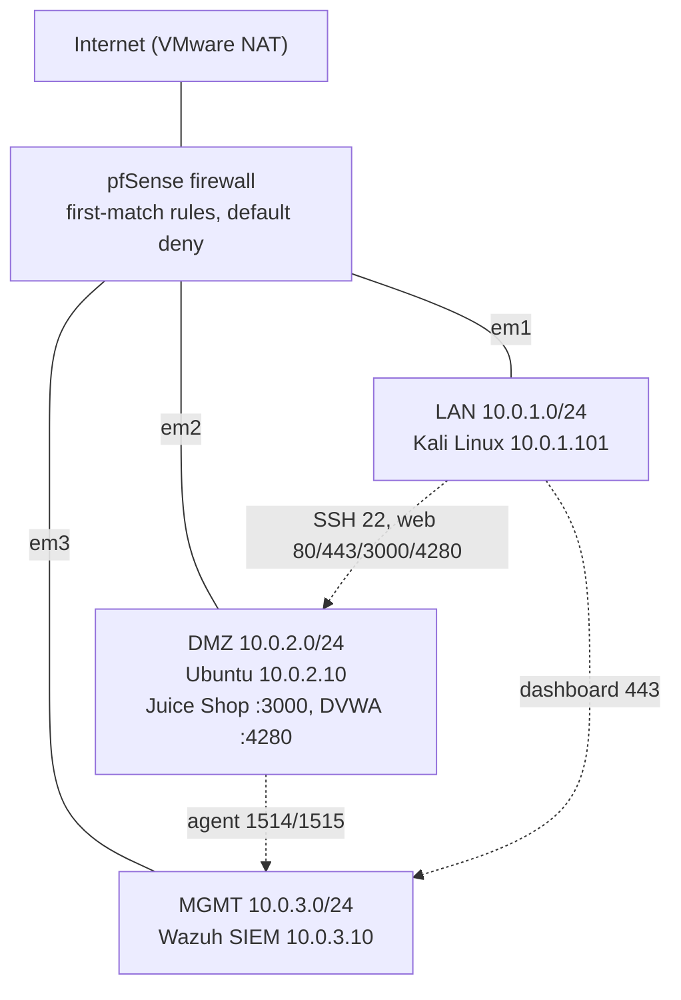
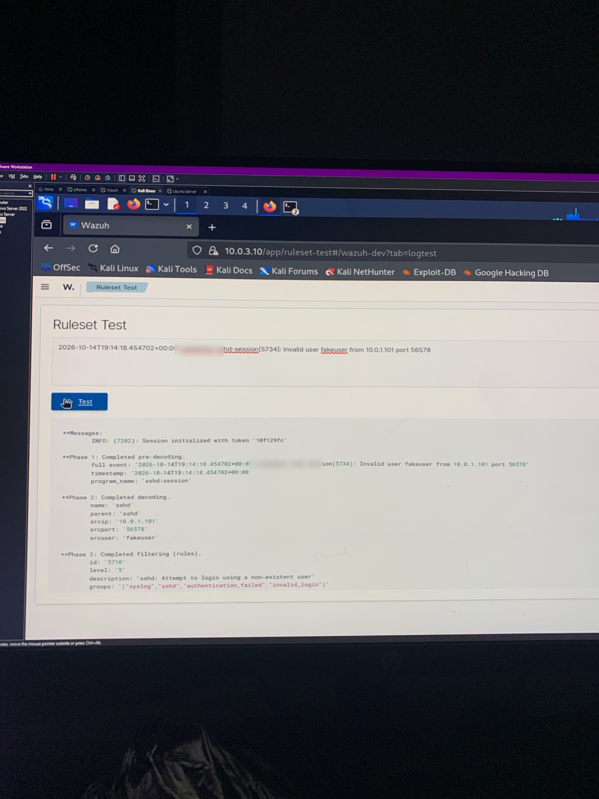
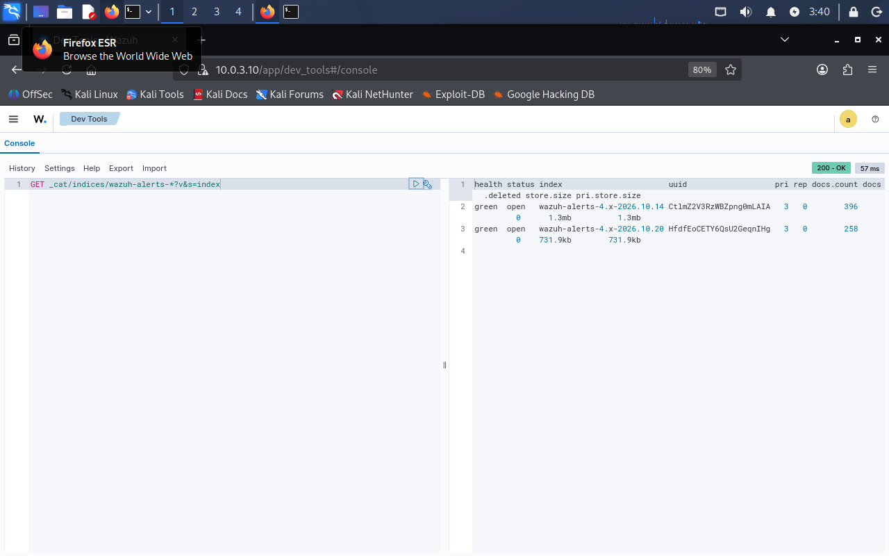
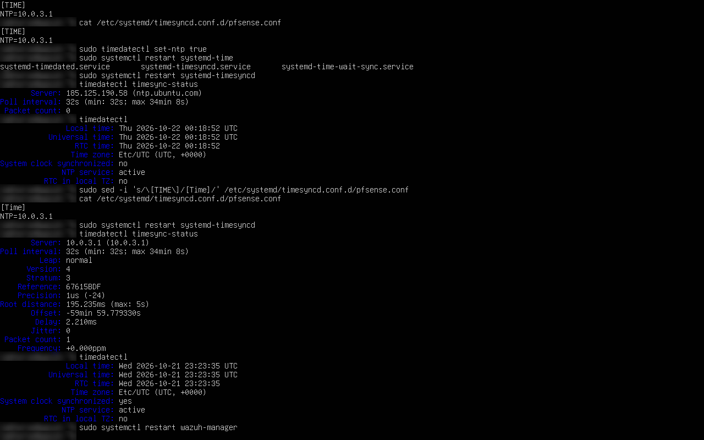
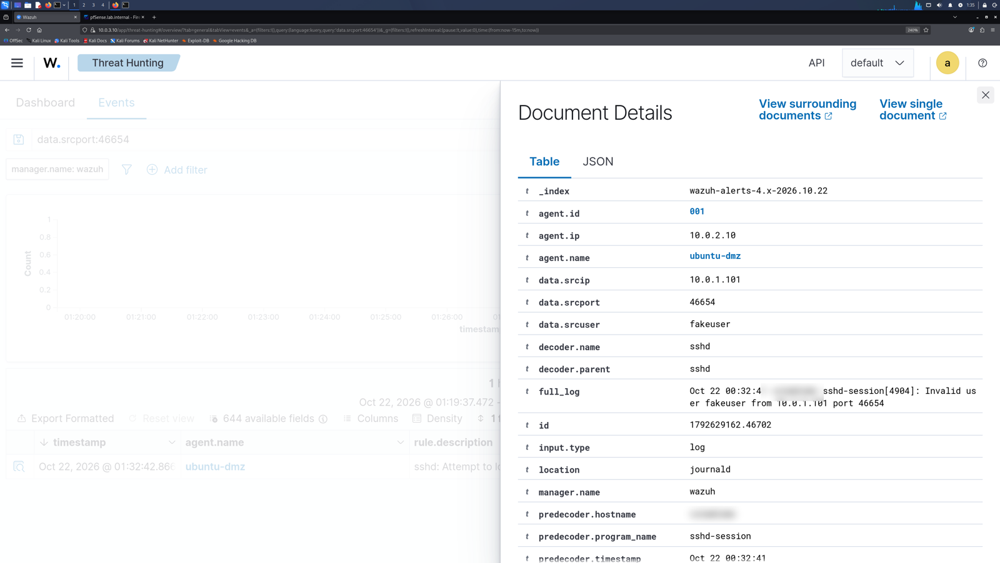
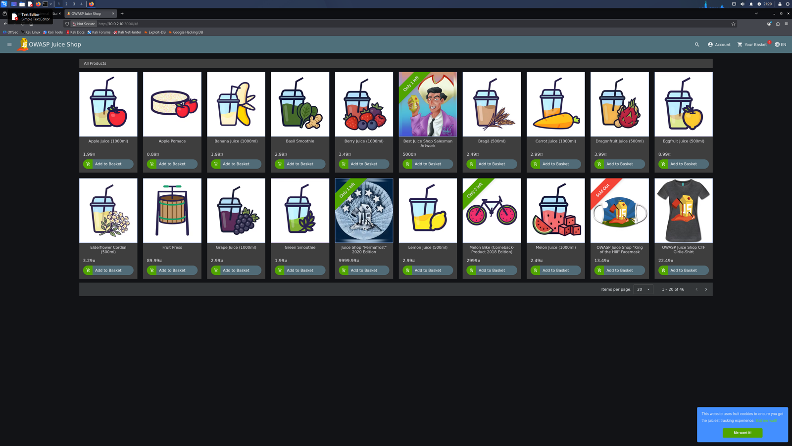
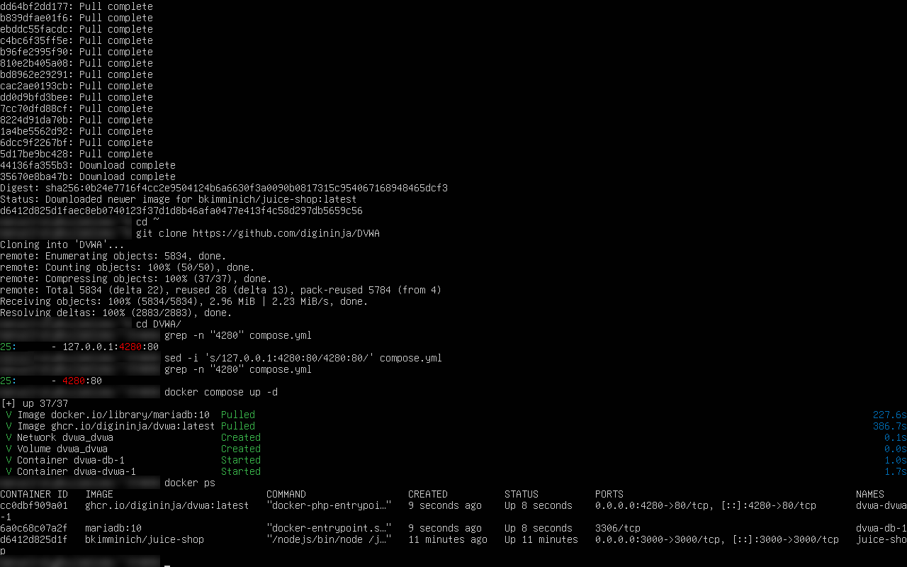

# SOC Home Lab: from segmented network to first detection

A hands-on Security Operations Center lab built on one laptop, documented as I learn. It covers network segmentation, hardening, vulnerable targets and a SIEM, with real troubleshooting along the way.

**Goal:** junior SOC analyst now, then cloud security, with AI security as a specialisation.
**Programme:** built during VAMP (28 days) with The Victor Akinode Foundation (AI & Cybersecurity) and Veenode Learn.

---

## Highlights

- **Segmented network:** three zones (LAN, DMZ, MGMT) behind a pfSense firewall, with least-privilege, default-deny rules.
- **Hardened target server:** Ubuntu in the DMZ running OWASP Juice Shop and DVWA in Docker. SSH uses keys only and is reachable only from the analyst machine.
- **SIEM:** Wazuh 4.14.8 (indexer, manager, dashboard) in the management zone, with an agent on the DMZ server.
- **First detection:** SSH login attempts from Kali raise Wazuh rule 5710, mapped to MITRE ATT&CK T1110.001 (Password Guessing).
- **Real incident write-up:** [Case 001](case-studies/001-invisible-ssh-alerts.md). Alerts were generated and stored but invisible. I traced the pipeline hop by hop to the root cause: a SIEM clock running 1 hour ahead. I later corrected one of my own conclusions when new evidence came in.
- **Lab-wide time sync:** pfSense is the internal NTP server; Wazuh (systemd-timesyncd) and the DMZ server (chrony) both sync from it. ([Phase 4.1](docs/phase-4-ntp-time-sync.md))
- **Brute-force detection:** 10 SSH attempts from Kali raised a level-10 correlation alert (rule 5712, T1110), plus a detection gap for distributed attacks. ([Case 002](case-studies/002-ssh-brute-force-detection.md))
- **Detection engineering:** wrote a custom Wazuh rule (100100) that catches low-and-slow SSH guessing the built-in rule misses, and proved it: 5712 silent, 100100 fired at level 10. ([Case 003](case-studies/003-custom-rule-low-and-slow-ssh.md), [rule file](detections/wazuh/local_rules.xml))
- **Alert hygiene:** found and removed a duplicate log source, so each SSH attempt now produces exactly one alert, verified by matching process ID and source port.

## Architecture

Everything else between zones is blocked and logged. Full details: [docs/architecture.md](docs/architecture.md).

## Progress

| Phase | What | Status |
| --- | --- | --- |
| 1 | [Segmented network with pfSense](docs/phase-1-network.md) | Done |
| 2 | [DMZ targets, SSH hardening, host firewall](docs/phase-2-dmz-targets.md) | Done |
| 3 | [Wazuh SIEM and first detection](docs/phase-3-wazuh-siem.md) | Done |
| 4 | [Time sync via pfSense NTP](docs/phase-4-ntp-time-sync.md) ✅ · duplicate-alert fix ✅ · next: pfSense logs into Wazuh, Windows + Active Directory, Sysmon | In progress |
| 5 | Attack-and-detect loops: [SSH brute force](case-studies/002-ssh-brute-force-detection.md) ✅, then nmap, Hydra, SQL injection, Atomic Red Team, capstone report | In progress |
| 6 | Cloud: rebuild the design in AWS and Azure; Microsoft Sentinel with KQL detections | Planned |
| 7 | AI security: Ollama + Open WebUI in the DMZ, prompt injection and jailbreak testing (garak, promptfoo, PyRIT), RAG poisoning, AI prompt-log detections in Wazuh, Llama Guard defence (OWASP LLM Top 10, MITRE ATLAS) | Planned |

Day-by-day notes: [progress-log.md](progress-log.md).

## Screenshots

| Wazuh rule 5710 matches the SSH attack | Alerts stored in the indexer |
| --- | --- |
|  |  |
| **Wazuh clock synced from pfSense** | **One SSH attempt = one alert** |
|  |  |
| **Juice Shop running in the DMZ** | **Containers on the DMZ server** |
|  |  |

More in [screenshots/](screenshots/). Usernames and hostnames are blurred.

## Skills shown

| Area | Skills |
| --- | --- |
| Networking | Segmentation, stateful firewall rules, aliases, NAT, TCP/IP, DNS, subnetting |
| Linux | systemd, logs, SSH keys and hardening, ufw, netplan, Docker, troubleshooting |
| Security | Least privilege, defence in depth, attack surface reduction, MITRE ATT&CK mapping |
| SOC / SIEM | Agent deployment, log collection, rule testing, alert triage, pipeline troubleshooting |

## Repository map

| Path | Contents |
| --- | --- |
| [docs/](docs/) | Architecture and the build guide for each phase |
| [detections/](detections/) | Custom detection rules, each documented and tested |
| [case-studies/](case-studies/) | Incident-style write-ups of real problems I solved |
| [notes/](notes/) | Networking fundamentals, command cheat sheet, interview answers |
| [screenshots/](screenshots/) | Evidence from each phase (usernames and hostnames blurred) |
| [posts/](posts/) | The carousels I shared on LinkedIn and X |

## Lab hardware

HP ZBook (i7-8850H, 32 GB RAM), VMware Workstation Pro, VMs on an external SSD.

> All attacks in this lab target only my own isolated machines. Vulnerable apps are never exposed to the internet.

## License

[MIT](./LICENSE) © 2026 Emmanuel Nwabuokei
