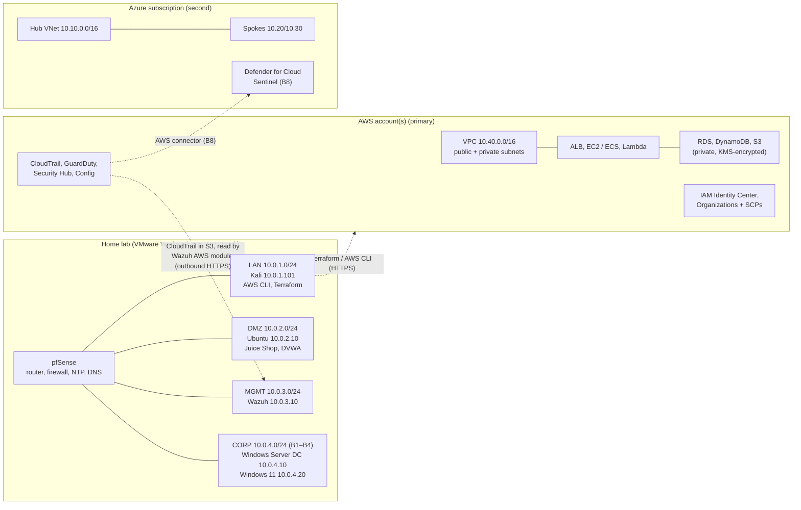

# Lab v2: hybrid on-prem + cloud

Lab v2 keeps everything already built (pfSense, Kali, the Ubuntu DMZ server and Wazuh) and grows it in three directions:

1. **AWS (primary cloud):** an account designed like a company's: VPCs, IAM, everything as Terraform code, and logs flowing back to the home SIEM.
2. **Azure (second cloud):** the same basics rebuilt in Azure, then Defender for Cloud and Sentinel.
3. **On-prem:** a **CORP** zone with Windows Server (Active Directory) and a Windows 11 client, built as part of the SOC thread.

Timeline: [ROADMAP.md](../ROADMAP.md) (sprints S1–S9, then B1–B10).

## Architecture

### Address plan (no overlaps)

| Network | Range | Purpose |
| --- | --- | --- |
| LAN | 10.0.1.0/24 | Analyst / attacker workstation (Kali), also where Terraform runs |
| DMZ | 10.0.2.0/24 | Exposed targets (Ubuntu, Docker apps) |
| MGMT | 10.0.3.0/24 | Security tooling (Wazuh) |
| CORP | 10.0.4.0/24 | Windows domain: DC 10.0.4.10, client 10.0.4.20 |
| **AWS VPC** | 10.40.0.0/16 | Primary cloud: public 10.40.1–2.0/24, private app 10.40.11–12.0/24, private data 10.40.21–22.0/24 |
| Azure hub | 10.10.0.0/16 | Shared services, Bastion |
| Azure spoke: web | 10.20.0.0/16 | Web tier |
| Azure spoke: data | 10.30.0.0/16 | Data tier, reachable only privately |

Cloud ranges **never overlap** with the home lab or each other. Overlapping ranges make it impossible to connect networks later.

### How cloud logs reach the home SIEM

CloudTrail writes logs to an S3 bucket. Wazuh's **AWS module** reads that bucket over **outbound HTTPS**, so there's no inbound firewall opening. Wazuh uses a dedicated IAM identity that can only read that one bucket (least privilege), and its keys are rotated and never committed to Git. A site-to-site VPN is an optional extra later; it's billed by the hour.

## Resource plan (32 GB RAM)

Not everything runs at once. Each session starts only what it needs.

| VM | RAM | Runs in |
| --- | --- | --- |
| pfSense | 1–2 GB | Every session |
| Kali | 4 GB | Every session (Terraform, AWS CLI) |
| Ubuntu DMZ | 2–4 GB | Linux and web sessions |
| Wazuh | 8 GB | Detection sessions (S1, S7, B5–B6) |
| Windows Server (DC) | 4 GB | SOC thread, Mar–Jun |
| Windows 11 client | 4 GB | SOC thread, Mar–Jun |

Most cloud sessions need only pfSense and Kali locally.

## Cloud safety rules (before any cloud lab)

1. **Root account:** MFA on, then locked away. Daily work uses an admin user from IAM Identity Center.
2. **Budget alerts** ($5 and zero-spend) before creating anything.
3. **Everything built with Terraform** from S4 on, so `terraform destroy` removes it all at the end of a session.
4. **No public IPs** on instances. Access through Session Manager (AWS) or Bastion (Azure).
5. **Tags** on every resource (`owner`, `sprint`) so nothing is forgotten.
6. **Expensive services only during a session:** NAT gateway, load balancers, RDS, EKS, WAF, Front Door.
7. **No access keys in Git.** Vulnerable apps **never** go in the cloud.

## Phases

| # | Phase | Key outcomes | When | Status |
| --- | --- | --- | --- | --- |
| 1 | [Segmented network](phase-1-network.md) | pfSense, three zones, aliases, least-privilege rules | | ✅ Done |
| 2 | [DMZ targets and hardening](phase-2-dmz-targets.md) | Docker, Juice Shop, DVWA, SSH keys, ufw | | ✅ Done |
| 3 | [SIEM](phase-3-wazuh-siem.md) | Wazuh all-in-one, agent, first detection, boot fix | | ✅ Done |
| 4 | [Lab reliability](phase-4-ntp-time-sync.md) | Lab-wide NTP via pfSense, duplicate-alert fix | | ✅ Done |
| 5 | **Detection engineering (Linux and network)** | ✅ SSH brute force ([Case 002](../case-studies/002-ssh-brute-force-detection.md)), ✅ custom rule 100100 ([Case 003](../case-studies/003-custom-rule-low-and-slow-ssh.md)); **pfSense logs into Wazuh + scan detection** (Case 004) | S1 | 🔄 In progress |
| 6 | **AWS foundations** | Secure account, IAM, VPC, EC2 with Session Manager, S3 + CloudFront + WAF static site | S1–S3 | Next |
| 7 | **Infrastructure as code** | Terraform modules and state in `infra/aws/`; build and destroy in one session | S4 | Planned |
| 8 | **Serverless, data, scaling, containers** | Lambda + API Gateway + DynamoDB, RDS, Cognito login, load balancer + Auto Scaling, ECR + ECS Fargate | S6–S7 | Planned |
| 9 | **Cloud logs → home SIEM** | CloudTrail → Wazuh AWS module; a detection from your own AWS activity (Case 005) | S7 | Planned |
| 10 | **Azure foundations** | Entra ID, VNet/NSG, VM, Storage, all with Terraform | S8 | Planned |
| ★A | **Phase A capstone** | 3-tier app on AWS from Terraform, with a diagram and write-up | S9 | Planned |
| 11 | **Identity + data security** | Organizations, SCPs, permission boundaries, Access Analyzer; KMS, Secrets Manager, Macie, Key Vault | B1–B2 | Planned |
| 12 | **Network, posture + DevSecOps** | Flow logs, VPC endpoints, WAF rules; Config, Security Hub, Prowler; Checkov in GitHub Actions | B3–B4 | Planned |
| 13 | **Cloud detection + incident response** | GuardDuty, Athena, detections as code in `detections/aws/`; GuardDuty → EventBridge → Lambda auto-response; 3 incident simulations | B5–B6 | Planned |
| 14 | **Container + serverless security** | ECR scanning, task roles, k3s at home, Lambda hardening | B7 | Planned |
| 15 | **Azure security + multi-cloud SIEM** | Defender for Cloud; Sentinel with AWS and Azure data; KQL rules | B8 | Planned |
| 16 | **Windows, AD and endpoints (SOC thread)** | CORP zone, DC + Windows 11, Sysmon, Wazuh agents, 4625/4720 detections | Mar–Jun weekends | Planned |
| ★B | **Phase B capstone** | Secure multi-account landing zone + app + central logging + detections + auto-response + an end-to-end incident write-up | B9 | Planned |
| 17 | **AI security** | Local LLM in the DMZ; prompt-injection testing; OWASP LLM Top 10 | 2028 | Planned |

## Repo layout as the lab grows

| Path | Contents |
| --- | --- |
| `docs/` | Phase guides and architecture |
| `case-studies/` | Incident-style write-ups |
| `detections/wazuh/` | Custom Wazuh rules |
| `detections/aws/` (B5) | Cloud detections |
| `detections/sentinel/` (B8) | KQL analytics rules |
| `infra/aws/` (S4) | Terraform for AWS |
| `infra/azure/` (S8) | Terraform for Azure |
| `.github/workflows/` (B4) | Checkov / security checks on every push |
| `notes/` | Study guides, cheat sheets, interview answers |
