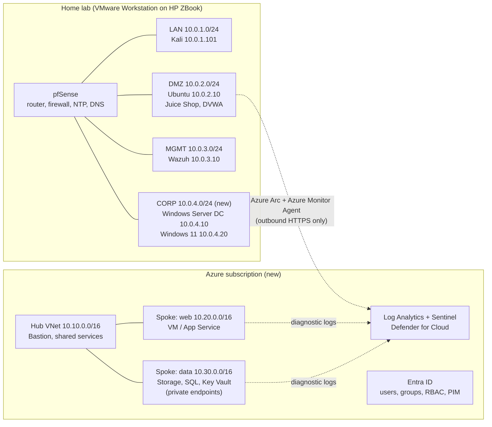

# Lab v2: hybrid on-prem + cloud

Lab v2 keeps everything already built (pfSense, Kali, the Ubuntu DMZ server and Wazuh) and grows it in two directions:

1. **On-prem:** a new **CORP** zone with Windows Server (Active Directory) and a Windows 11 client, which is what most companies run.
2. **Cloud:** an **Azure** environment designed like a company's landing zone, connected to the home lab so one investigation can span both. AWS is added later.

## Architecture

### Address plan (no overlaps)

| Network | Range | Purpose |
| --- | --- | --- |
| LAN | 10.0.1.0/24 | Analyst / attacker workstation (Kali) |
| DMZ | 10.0.2.0/24 | Exposed targets (Ubuntu, Docker apps) |
| MGMT | 10.0.3.0/24 | Security tooling (Wazuh) |
| **CORP** (new) | 10.0.4.0/24 | Windows domain: DC 10.0.4.10, client 10.0.4.20 |
| **Azure hub** | 10.10.0.0/16 | Shared services, Bastion |
| **Azure spoke: web** | 10.20.0.0/16 | Web tier |
| **Azure spoke: data** | 10.30.0.0/16 | Data tier, reachable only privately |
| AWS VPC (later) | 10.40.0.0/16 | The same design rebuilt in AWS |

Cloud ranges are chosen so they **never overlap** with the home lab. Overlapping ranges make it impossible to connect networks later.

### Why the hybrid link uses Azure Arc, not a VPN

A site-to-site VPN from pfSense to an Azure VPN gateway is the "real company" design, but the gateway is billed by the hour. **Azure Arc** onboards the on-prem Ubuntu server using **outbound HTTPS only**, so there's no inbound firewall opening and no gateway cost. A VPN can be added later as an optional exercise. Check current pricing before enabling any paid service.

## Resource plan (32 GB RAM)

Not everything runs at once. Each session starts only what it needs.

| VM | RAM | Runs in |
| --- | --- | --- |
| pfSense | 1–2 GB | Every session |
| Kali | 4 GB | Every session |
| Ubuntu DMZ | 2–4 GB | Linux and web sessions |
| Wazuh | 8 GB | Detection sessions |
| Windows Server (DC) | 4 GB | Windows and AD sessions |
| Windows 11 client | 4 GB | Windows and AD sessions |

A full Windows session (pfSense, Kali, Wazuh, DC and client) uses about **21–22 GB**, which leaves room for the host. Cloud sessions need only pfSense and Kali locally.

## Cloud safety rules (before any cloud lab)

1. **MFA** on the account that owns the subscription. Never use it day to day; use a separate admin user.
2. **A budget with alerts** at low thresholds before creating anything.
3. **Everything built with Terraform**, so `terraform destroy` removes it all at the end of a session.
4. **No public IPs** on VMs. Access goes through Bastion or Arc only.
5. **Tags** on every resource (`owner`, `lab-phase`) so nothing is forgotten.
6. Vulnerable apps **never** go in the cloud.

## Phases

Timeline: see the quarter-by-quarter plan in [ROADMAP.md](../ROADMAP.md). Phases 1–11 and the capstone fit November 2026 to December 2027; phases 12–13 follow in 2028.

| # | Phase | Key outcomes | Status |
| --- | --- | --- | --- |
| 1 | [Segmented network](phase-1-network.md) | pfSense, three zones, aliases, least-privilege rules | ✅ Done |
| 2 | [DMZ targets and hardening](phase-2-dmz-targets.md) | Docker, Juice Shop, DVWA, SSH keys, ufw | ✅ Done |
| 3 | [SIEM](phase-3-wazuh-siem.md) | Wazuh all-in-one, agent, first detection, boot fix | ✅ Done |
| 4 | [Lab reliability](phase-4-ntp-time-sync.md) | Lab-wide NTP via pfSense, duplicate-alert fix | ✅ Done |
| 5 | **Detection engineering (Linux and network)** | ✅ SSH brute force ([Case 002](../case-studies/002-ssh-brute-force-detection.md)), ✅ custom rule 100100 ([Case 003](../case-studies/003-custom-rule-low-and-slow-ssh.md)); next: failures-then-success rule, **pfSense logs into Wazuh** and network scan detection, web attack detection from DVWA and Juice Shop logs | 🔄 In progress |
| 6 | **Windows, Active Directory and endpoint security** | Add the CORP zone in pfSense; Windows Server DC and a Windows 11 client; Sysmon; Wazuh agents; detections for logon failures (4625), new accounts (4720), group changes, suspicious PowerShell; **Wazuh vulnerability detection and configuration assessment (SCA)**; patching; **backup and tested restore**; a **monthly security report** generated from Wazuh data | Next |
| 7 | **Virtualization and containers** | Hypervisor and virtual networking deep dive (Guide 2); Docker hardening; image scanning; a lightweight Kubernetes cluster (k3s) on Ubuntu; container detections | Next |
| 8 | **Azure foundations** | Secure account setup; hub-and-spoke VNets with Terraform; NSGs; Bastion; a VM and an App Service; Blob storage; Azure SQL with a private endpoint; Queue Storage | Planned |
| 9 | **Cloud identity and data security** | Entra ID users and groups; MFA and Conditional Access as a small business would use them; email authentication (SPF, DKIM, DMARC); RBAC least privilege; managed identities; Conditional Access and PIM (trial); Key Vault; encryption at rest and in transit; Azure Policy; Defender for Cloud recommendations | Planned |
| 10 | **Cloud detection (hybrid SIEM)** | Log Analytics and Sentinel; onboard the on-prem Ubuntu with Azure Arc; KQL rewrites of the lab's Wazuh rules (5712, 100100); Entra ID sign-in detections | Planned |
| 11 | **Cloud incident response** | Simulated incidents (leaked credential, exposed storage, compromised VM); isolate, preserve evidence (disk snapshots), revoke and rotate; an automated Sentinel playbook | Planned |
| 12 | **AWS** *(2028, after the CDR target)* | The same design in AWS with Terraform (VPC, security groups, IAM roles, S3, EC2); CloudTrail, GuardDuty, Config, Security Hub; a posture scan with Prowler | Planned |
| 13 | **AI security** *(2028)* | Local LLM (Ollama) in the DMZ; prompt-injection testing; AI prompt-log detections; mapped to the OWASP LLM Top 10 and MITRE ATLAS | Planned |
| ★ | **Capstone** | A secure 3-tier app in Azure (Terraform), monitored by Sentinel together with the on-prem lab, then a simulated incident investigated end to end and written up | Planned |

## Repo layout as the lab grows

| Path | Contents |
| --- | --- |
| `docs/` | Phase guides and architecture |
| `case-studies/` | Incident-style write-ups |
| `detections/wazuh/` | Custom Wazuh rules |
| `detections/sentinel/` (later) | KQL analytics rules |
| `infra/azure/` (later) | Terraform for the Azure landing zone |
| `infra/aws/` (later) | Terraform for the AWS mirror |
| `notes/` | Study guides, cheat sheets, interview answers |
