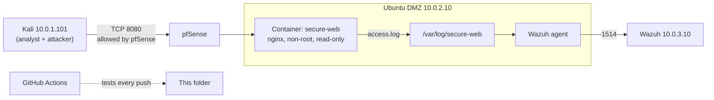

# Mini-project 01 · A hardened, monitored web service

**One small build that touches every fundamental:** a website in a locked-down Docker container on my Ubuntu DMZ server, opened to my analyst machine through pfSense, logging to Wazuh, attacked from Kali, and tested automatically by GitHub Actions on every push.

| Stage | What this project practises |
| --- | --- |
| Systems | Processes, users and IDs (uid 101), file permissions, resource limits |
| Linux | systemd and Docker services, Bash scripting (`set -euo pipefail`), logs, `ss`, `curl` |
| Networking | Ports, binding to one IP, pfSense firewall rules, TCP handshake seen with nmap |
| Security | Least privilege, defence in depth, attack-surface reduction, security headers |
| Virtualization / containers | Docker Compose, read-only containers, dropped capabilities, health checks |
| DevOps | Git workflow, idempotent deploy script, automated tests in CI (GitHub Actions) |
| Blue team | Web logs in Wazuh, detecting scans and injection attempts, writing up findings |
| Cloud (mapping) | How each control maps to AWS (section 7) |

**Time:** about 4–5 hours · **Cost:** $0 · **Runs on:** Ubuntu DMZ (10.0.2.10), Kali, pfSense, Wazuh

## 1. Architecture



## 2. Files

| File | What it does |
| --- | --- |
| `docker-compose.yml` | Defines the container and every hardening setting |
| `nginx.conf` | Web server config: security headers, hidden version, only GET/HEAD allowed, `/health` endpoint |
| `site/index.html` | The website |
| `deploy.sh` | Creates the log folder, starts the container, waits until it's healthy. Safe to run again. |
| `check.sh` | Proves each security setting is really applied (PASS/FAIL) |
| `.env.example` | Server settings (copy to `.env`; `.env` is never committed) |
| `../../.github/workflows/mini-01-web-service.yml` | CI: lint, deploy and run `check.sh` on GitHub's servers |

## 3. The hardening, line by line

| Setting | What it does | Principle |
| --- | --- | --- |
| `nginx-unprivileged` image | nginx runs as user 101, not root | Least privilege |
| `BIND_IP:8080` | Listens on one chosen address, not every interface | Attack-surface reduction |
| `read_only: true` + `tmpfs: /tmp` | The container can't modify its own files; only `/tmp` is writable (in memory) | An attacker can't plant files |
| `cap_drop: ALL` | Removes every special Linux power (capability) | Least privilege |
| `no-new-privileges` | No process can gain more privileges (e.g. through setuid programs) | Least privilege |
| `mem_limit`, `pids_limit` | Caps memory and process count | Availability (stops resource exhaustion) |
| Site and config mounted `:ro` | Content can't be changed from inside | Integrity |
| `server_tokens off` | Hides the nginx version from attackers | Less information for reconnaissance |
| Security headers | Browsers block MIME sniffing, framing and content from other sites | Defence in depth |
| Only GET/HEAD | Other HTTP methods return 405 | Attack-surface reduction |
| Health check | Docker knows when the service is broken | Availability, observability |

## 4. Build it (step by step)

### Step 1: Get the code onto the Ubuntu server (Git)
```bash
cd ~
git clone https://github.com/emmanuelrukevwe123-lgtm/soc-home-lab.git   # or: cd soc-home-lab && git pull
cd soc-home-lab/mini-projects/01-hardened-web-service
cp .env.example .env          # BIND_IP=10.0.2.10, LOG_DIR=/var/log/secure-web
cat docker-compose.yml        # read it before you run it
```

### Step 2: Deploy
```bash
./deploy.sh
docker ps                     # STATUS should say "(healthy)"
```

### Step 3: Prove the hardening
```bash
./check.sh                    # every line should say PASS
ps aux | grep [n]ginx         # which user owns the nginx processes on the host? Why a number?
docker exec secure-web touch /usr/share/nginx/html/hacked.txt   # should FAIL: read-only
ss -tlnp | grep 8080          # listening on 10.0.2.10 only?
```

### Step 4: The network (pfSense)
1. **Before any rule:** from Kali run `nmap -p 8080 10.0.2.10` and `curl -I http://10.0.2.10:8080`. What state does nmap report: *filtered* or *closed*? Why?
2. **Add a rule** on the **LAN** tab: Pass · TCP · source `10.0.1.101` (Kali) · destination `10.0.2.10` · port `8080` · description "Mini-01 web". Put it above any block rules.
3. **After:** repeat both commands. Now *open*, and `curl` shows the security headers.
4. **The Docker + ufw lesson:** on Ubuntu, `sudo ufw status`. Is 8080 allowed in ufw? It isn't, yet Kali can reach it. Docker writes its own iptables rules, which bypass ufw. That's why **pfSense is the real control** here (defence in depth means knowing which layer actually enforces).

### Step 5: Logs into Wazuh
Add to the Wazuh agent's config on Ubuntu (`sudo nano /var/ossec/etc/ossec.conf`), inside `<ossec_config>`:
```xml
<localfile>
  <log_format>syslog</log_format>
  <location>/var/log/secure-web/access.log</location>
</localfile>
```
Then `sudo systemctl restart wazuh-agent` and visit the site from Kali a few times. `sudo tail -f /var/log/secure-web/access.log` should show each request.

### Step 6: Attack it and detect it (your own lab only)
From Kali:
```bash
nmap -sV -p 8080 10.0.2.10                                   # can nmap tell the version? (server_tokens off)
curl -s "http://10.0.2.10:8080/?id=1'%20OR%20'1'='1"         # SQL-injection-style request
curl -s "http://10.0.2.10:8080/?q=<script>alert(1)</script>" # XSS-style request
curl -s -X POST http://10.0.2.10:8080/                       # expect 405
for p in admin .env wp-login.php phpmyadmin .git/config; do curl -s -o /dev/null -w "%{http_code} /$p\n" "http://10.0.2.10:8080/$p"; done   # path probing
```
In Wazuh, search for the agent's web events (`rule.groups: web` or `location: /var/log/secure-web/access.log`). Which requests raised alerts, at what level, and which didn't? Take screenshots.

### Step 7: Push and watch CI
Commit any notes from Kali or your laptop, push, then open the repo's **Actions** tab: the workflow lints the scripts, deploys the container on a GitHub server and runs `check.sh`. A green tick means the hardening is proven automatically on every change.

## 5. Results (fill in)

| Test | Expected | Result |
| --- | --- | --- |
| `check.sh` | All PASS | _ |
| Write to the site from inside the container | Read-only error | _ |
| nmap before the pfSense rule | filtered | _ |
| nmap after the rule | open | _ |
| ufw vs Docker | Reachable despite ufw | _ |
| nmap `-sV` version | No nginx version | _ |
| POST request | 405 | _ |
| SQLi / XSS requests in Wazuh | Alert? Level? | _ |
| Path probing in Wazuh | Alert? Level? | _ |
| CI run | Green tick | _ |

## 6. Screenshots to take (redacted)

`01-check-sh-pass.png` · `02-docker-ps-healthy.png` · `03-readonly-fail.png` · `04-nmap-before-after.png` · `05-pfsense-rule.png` · `06-curl-headers.png` · `07-wazuh-web-alerts.png` · `08-github-actions-green.png`

## 7. How this maps to the cloud

| Here | AWS equivalent |
| --- | --- |
| pfSense rule for TCP 8080 from Kali only | Security group allowing 8080 from one source |
| Read-only, non-root container with no capabilities | ECS task: `readonlyRootFilesystem`, non-root `user`, dropped capabilities |
| `mem_limit`, `pids_limit` | ECS task CPU/memory limits |
| Health check | Load balancer target health checks |
| Logs to Wazuh | Logs to CloudWatch Logs → SIEM |
| GitHub Actions test on push | CI/CD pipeline (P12 in my plan) |

## 8. Explain it back (answer in your own words)

1. Why does running as uid 101 matter if an attacker breaks into nginx?
2. Why did Kali reach port 8080 even though ufw didn't allow it?
3. What's the difference between nmap saying *filtered* and *closed*?
4. Why is `deploy.sh` "idempotent", and why does that matter in DevOps?
5. Which request from step 6 would be the most worrying in a real log, and why?
