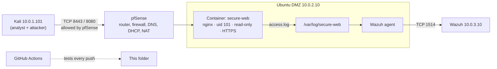

# Extension E1 · A hardened, monitored web service (optional, after mini-project 01)

**One build that teaches every fundamental in stages 1–4:** a website in a locked-down Docker container on the Ubuntu DMZ server, served over HTTPS from my own certificate authority, with a password-protected admin page. I open it to Kali through pfSense, send its logs to Wazuh, attack it from Kali and detect the attack. GitHub Actions re-tests the hardening on every push.

**Time:** two days (about 4–5 hours each) · **Cost:** $0 · **Machines:** Ubuntu DMZ (10.0.2.10), Kali (10.0.1.101), pfSense, Wazuh (10.0.3.10)

| Day | Parts |
| --- | --- |
| **Day 1** | Part A: deploy · Part 1: how computers and systems work · Part 2: Linux and the command line |
| **Day 2** | Part 3: networking · Part 4: security fundamentals + attack and detect · write-up |

## What this teaches (every topic, and where)

| Stage | Topic | Where in this project |
| --- | --- | --- |
| **1 · Systems** | CPU, RAM, storage | 1.1 |
| | Operating system and kernel | 1.2 |
| | Processes | 1.3 |
| | File systems | 1.4 |
| | Users and permissions | 1.5 |
| **2 · Linux** | Files and folders | 2.1 |
| | Permissions | 1.5, 2.1 |
| | Services (systemd) | 2.2 |
| | Logs | 2.3 |
| | Packages | 2.4 |
| | SSH | 2.5 |
| | Bash | 2.6 |
| **3 · Networking** | OSI and TCP/IP models | 3.1 |
| | IP addresses and subnetting | 3.2 |
| | Ports and protocols, TCP vs UDP | 3.3 |
| | The TCP handshake | 3.4 |
| | Routing | 3.5 |
| | Firewalls | 3.6 |
| | NAT | 3.7 |
| | DHCP | 3.8 |
| | DNS | 3.9 |
| | HTTP and HTTPS | 3.10 |
| **4 · Security** | CIA | 4.1 |
| | Least privilege, defence in depth | 4.2 |
| | Zero trust | 4.3 |
| | Risk and threat modelling (STRIDE) | 4.4 |
| | Cryptography: hashing, keys, certificates | 4.5 |
| | TLS | 4.6 |
| | Authentication | 4.7 |
| | Common attacks + detection | 4.8 |

## Architecture



## Files

| File | What it does |
| --- | --- |
| `docker-compose.yml` | The container and every hardening setting |
| `nginx.conf` | HTTP → HTTPS redirect, TLS settings, security headers, GET/HEAD only, `/admin/` login, `/health` |
| `site/` | The website and the admin page |
| `make-certs.sh` | Creates my own certificate authority and a server certificate it signs |
| `make-user.sh` | Creates the admin login, stored only as a salted SHA-512 hash |
| `deploy.sh` | Sets ownership, starts the container, waits until it's healthy. Safe to run again. |
| `check.sh` | Proves every security setting (PASS/FAIL) |
| `.env.example` | Server settings (copy to `.env`). `.env`, `tls/`, `auth/` and `logs/` are never committed. |
| `../../.github/workflows/e1-web-service.yml` | CI: lint, create certs and login, deploy, run `check.sh` |

---

# DAY 1

## Part A · Deploy (about 30 min)

```bash
# On the Ubuntu DMZ server
cd ~ && git clone https://github.com/emmanuelrukevwe123-lgtm/soc-home-lab.git    # or: cd ~/soc-home-lab && git pull
cd ~/soc-home-lab/mini-projects/e1-hardened-web-service
cp .env.example .env          # BIND_IP=10.0.2.10, LOG_DIR=/var/log/secure-web
cat docker-compose.yml nginx.conf   # read before you run
./make-certs.sh               # your own CA + server certificate (to recreate later: sudo rm -rf tls, then run again)
./make-user.sh                # choose an admin password (it's never stored in plain text)
./deploy.sh
docker ps                     # STATUS: Up ... (healthy)
./check.sh                    # every line PASS (add ADMIN_PASSWORD=... to test the login too)
```

## Part 1 · How computers and systems work

### 1.1 CPU, RAM, storage
```bash
lscpu | head -15              # CPU model, cores, threads
free -h                       # RAM: total, used, available
df -h /                       # disk space on the root file system
lsblk                         # disks and partitions
docker stats --no-stream secure-web   # the container's CPU %, memory use and its 128 MiB limit
```
**Notice:** the CPU and RAM Ubuntu reports are what you gave the VM in VMware, not the ZBook's real total. That's virtualization: the hypervisor hands each VM a slice. `mem_limit: 128m` slices it again for one container.
**Question:** what happens to a container that tries to use more than its memory limit?

### 1.2 Operating system and kernel
```bash
uname -r                              # the kernel version on Ubuntu
docker exec secure-web uname -r       # the SAME version inside the container
docker exec secure-web cat /etc/os-release | head -2   # but a different OS userland (Alpine)
```
**Lesson:** a container is not a VM. It **shares the host's kernel** and only brings its own files and programs. A VM has its own kernel. That's why a kernel vulnerability can affect every container on a host.

### 1.3 Processes
```bash
ps -ef | grep [n]ginx                 # nginx processes as seen from the host: note the PIDs and the user
docker top secure-web                 # the same processes, as Docker sees them
docker exec secure-web ps             # inside: nginx's master is PID 1
```
**Lesson:** the container has its own **process namespace**: inside, nginx thinks it's PID 1; on the host it has a normal PID. One master process starts worker processes that handle requests.
**Question:** why do the host PIDs and container PIDs differ for the same process?

### 1.4 File systems
```bash
docker exec secure-web df -h          # what the container sees
docker exec secure-web mount | grep -E ' / | /tmp | /usr/share/nginx/html '
docker exec secure-web touch /usr/share/nginx/html/hacked.txt   # expect: Read-only file system
docker exec secure-web touch /tmp/ok.txt && echo "/tmp is writable (tmpfs, in RAM)"
```
**Lesson:** the root file system is mounted **ro** (read-only); `/tmp` is **tmpfs**, a file system that lives in RAM and disappears when the container stops. Website files are a **bind mount** from the host, also read-only.

### 1.5 Users and permissions
```bash
docker exec secure-web id                     # uid=101(nginx): not root
ps -o user,pid,cmd -C nginx                   # on the host the user shows as 101 (or another name for uid 101). Why?
ls -ln tls/ auth/                             # numbers instead of names: owner 101 for server.key and .htpasswd
stat -c '%a %U %n' tls/server.key auth/.htpasswd   # 600 = owner read/write only
cat tls/server.key                            # Permission denied for you. Good.
```
**Lesson:** Linux checks the **user ID number**, not the name. The host and the container can give uid 101 different names, but it's the same number. The private key is owned by 101 with mode **600** (rw-------), so only nginx can read it, and not even your normal user.
**Question:** why is `chmod 600` right for a private key, and what would `644` expose?

## Part 2 · Linux and the command line

### 2.1 Files and folders (where things live)
| Path | Holds | In this project |
| --- | --- | --- |
| `/etc` | Configuration | `/etc/ssh/sshd_config.d/`, `/var/ossec/etc/ossec.conf` |
| `/var/log` | Logs | `/var/log/secure-web/access.log` |
| `/home/<you>` | Your files | the cloned repo |
| `/usr/bin` | Programs | `docker`, `curl`, `openssl` |
```bash
tree -L 2 ~/soc-home-lab/mini-projects 2>/dev/null || ls -R ~/soc-home-lab/mini-projects | head -30
ls -la                         # hidden files (.env, .gitignore) start with a dot
```

### 2.2 Services (systemd)
```bash
systemctl status docker --no-pager     # the service that runs containers
systemctl is-enabled docker            # starts at boot?
systemctl status wazuh-agent --no-pager
systemctl list-units --type=service --state=running | head -20
```
**Lesson:** systemd starts and supervises long-running services. Docker is one; your container is supervised by Docker (`restart: unless-stopped`).

### 2.3 Logs
```bash
sudo tail -f /var/log/secure-web/access.log      # then load the site from Kali and watch requests appear (Ctrl+C to stop)
docker logs --tail 20 secure-web                 # the container's own output
journalctl -u docker --since "1 hour ago" --no-pager | tail -20
sudo journalctl -u ssh --since today --no-pager | tail -10
```
**Read one access-log line field by field:** client IP · time · request (method, path, protocol) · status code · bytes · referrer · user agent.

### 2.4 Packages
```bash
apt list --installed 2>/dev/null | wc -l          # how many packages
apt policy docker-ce 2>/dev/null | head -3 || apt policy docker.io | head -3   # installed vs available version
sudo apt update && apt list --upgradable           # what needs patching?
docker image ls                                    # container images are packages too
```
**Lesson:** patching is the #1 defence against known vulnerabilities. The image tag `1.27-alpine` pins a version, so updates happen when you choose them, not by surprise.

### 2.5 SSH
From Kali:
```bash
ssh <ubuntu-user>@10.0.2.10 'hostname; uptime'      # run one command over SSH, key-based
sudo sshd -T | grep -E 'passwordauthentication|permitrootlogin|pubkeyauthentication'   # on Ubuntu: your hardening
scp <ubuntu-user>@10.0.2.10:~/soc-home-lab/mini-projects/e1-hardened-web-service/tls/ca.crt ~/lab-ca.crt   # copy the CA cert to Kali (you'll need it on day 2)
```
**Lesson:** the server proves its identity with its **host key** (the fingerprint you accepted the first time); you prove yours with your **private key**. Passwords are off, so there's nothing to guess.

### 2.6 Bash
Read `deploy.sh` and explain each line in your notes, especially:
- `set -euo pipefail` (stop on errors, unset variables and failed pipes)
- `[ "$(id -u)" -eq 0 ] || SUDO="sudo"` (a test and a fallback)
- the `for` loop that waits for the health check

**Write your own (10 minutes):** a script `top-ips.sh` that prints the 5 IP addresses with the most requests in the access log:
```bash
sudo awk '{print $1}' /var/log/secure-web/access.log | sort | uniq -c | sort -rn | head -5
```
Turn that into a script with `#!/usr/bin/env bash`, `set -euo pipefail` and the log path as an argument.

**End of day 1:** run `./check.sh` again, screenshot it, push your notes.

---

# DAY 2

## Part 3 · Networking

### 3.1 OSI and TCP/IP: one request, every layer
When Kali loads `https://10.0.2.10:8443/`:

| TCP/IP layer | OSI layers | What happens here |
| --- | --- | --- |
| Application | 7 · 6 · 5 | HTTP request inside TLS encryption |
| Transport | 4 | TCP, destination port **8443**, source port random |
| Internet | 3 | IP from **10.0.1.101** to **10.0.2.10**, routed by pfSense |
| Link | 2 · 1 | Ethernet frames between MAC addresses on each virtual network |

### 3.2 IP addresses and subnetting
```bash
ip -br a                     # on Ubuntu and on Kali: each machine's address and prefix
ip route                     # the default gateway: pfSense's address on that subnet
```
Fill in for the DMZ (10.0.2.0/24) and LAN (10.0.1.0/24): network address · broadcast address · first and last usable address · number of usable hosts. Then: **are Kali and Ubuntu on the same subnet? So what must sit between them?**
*Check:* `ipcalc 10.0.2.10/24` (install with `sudo apt install ipcalc` if missing).

### 3.3 Ports and protocols; TCP vs UDP
```bash
sudo ss -tlnp | grep -E '8080|8443|22'     # TCP ports listening (t = TCP, l = listening)
sudo ss -ulnp                              # UDP ports (chrony's NTP client, DNS...)
```
| | TCP | UDP |
| --- | --- | --- |
| Connection | Handshake first | None: just sends |
| Reliability | Retransmits, in order | No guarantee |
| Here | HTTP/HTTPS 8080/8443, SSH 22, Wazuh 1514 | DNS 53, NTP 123, syslog 514 |

### 3.4 The TCP handshake, seen live
On Ubuntu: `sudo tcpdump -ni any 'tcp port 8443' -c 12`
On Kali: `curl -sk https://10.0.2.10:8443/ -o /dev/null`
Find **SYN → SYN-ACK → ACK** in the output (flags `[S]`, `[S.]`, `[.]`), then the data, then the close (`[F.]`).

### 3.5 Routing
From Kali:
```bash
traceroute -n 10.0.2.10      # one hop: pfSense (10.0.1.1), then the server
traceroute -n 1.1.1.1        # pfSense, then your VMware/home network, then the internet
```
**Lesson:** different subnets need a **router**. pfSense routes between LAN and DMZ, and it's also where the firewall rules apply.

### 3.6 Firewalls
1. **Before any rule**, from Kali: `nmap -Pn -p 8080,8443 10.0.2.10`. Expect **filtered**: pfSense drops the packets silently.
2. **pfSense → Firewall → Rules → LAN:** Pass · TCP · source `10.0.1.101` · destination `10.0.2.10` · ports `8080` and `8443` (use a port alias `Mini01_Web`) · description "Mini-01 web". Place it above any block rules. **Apply.**
3. **After:** run the same nmap again. Now **open**.
4. **The Docker + ufw lesson:** on Ubuntu, `sudo ufw status`. 8443 isn't allowed in ufw, yet Kali reaches it. **Docker inserts its own iptables rules, which skip ufw.** In this design, pfSense is the control that actually enforces access. Defence in depth means knowing which layer really works.
5. **filtered vs closed:** `nmap -Pn -p 9999 10.0.2.10` (blocked by pfSense) shows *filtered*; from Ubuntu itself, `nc -zv 127.0.0.1 9999` says *Connection refused*, which nmap calls *closed* (the host answered "nothing here"). Explain the difference.

### 3.7 NAT
```bash
curl -s https://ifconfig.me; echo       # from Ubuntu: the PUBLIC address the internet sees
ip -br a                                 # versus its private 10.0.2.10
```
**Lesson:** private addresses (10.x, 172.16–31.x, 192.168.x) can't travel on the internet. pfSense (and VMware, and your home router) rewrite the source address on the way out: **NAT**. Replies come back to the translated address and are mapped back.

### 3.8 DHCP
pfSense → **Status → DHCP Leases**: which devices got addresses automatically?
On Kali: `ip -br a` and `nmcli dev show | grep -iE 'ip4.address|gateway|dns'` (if NetworkManager is in use).
**Lesson:** DHCP's four steps are **D**iscover → **O**ffer → **R**equest → **A**cknowledge (DORA). Servers like Ubuntu and Wazuh use **static** addresses (netplan) so their addresses never change; clients usually use DHCP.

### 3.9 DNS
1. pfSense → **Services → DNS Resolver → Host Overrides → Add:** host `secure-web`, domain `lab`, IP `10.0.2.10`. Save and apply.
2. From Kali:
```bash
dig secure-web.lab +short                # → 10.0.2.10, answered by pfSense (if empty: dig @10.0.1.1 secure-web.lab, and check Kali's DNS server)
dig secure-web.lab                       # read: QUESTION, ANSWER, the server that answered, TTL
curl -I --cacert ~/lab-ca.crt https://secure-web.lab:8443/   # works: the name is in the certificate's SAN
curl -I --cacert ~/lab-ca.crt https://10.0.2.10:8443/        # also works: the IP is in the SAN too
```
**Lesson:** DNS turns names into IP addresses. Certificates are tied to names (and IPs) listed in their **subjectAltName**, which is why the name you connect with matters for HTTPS.

### 3.10 HTTP and HTTPS
```bash
curl -sI http://secure-web.lab:8080/                       # 301 → https://...
curl -sI --cacert ~/lab-ca.crt https://secure-web.lab:8443/ # 200 + security headers
curl -s -o /dev/null -w '%{http_code}\n' --cacert ~/lab-ca.crt -X POST https://secure-web.lab:8443/   # 405
```
**Wireshark on Kali:** capture while you load `http://secure-web.lab:8080/health` and then `https://secure-web.lab:8443/`. In the HTTP capture you can **read** the request; in the HTTPS capture you see a **TLS handshake** and then unreadable "Application Data". That's encryption in transit.

## Part 4 · Security fundamentals and the security mindset

### 4.1 CIA: map each control
| Control in this project | Confidentiality | Integrity | Availability |
| --- | --- | --- | --- |
| HTTPS (TLS) | ✓ | ✓ | |
| Read-only container and site files | | ✓ | |
| Admin login | ✓ | ✓ | |
| `mem_limit`, `pids_limit`, health check, restart policy | | | ✓ |
| Logs in Wazuh | (detects breaches of all three) | | |
Add any controls you think are missing, and say which letter they protect.

### 4.2 Least privilege and defence in depth
List every layer an attacker on the internet would have to get through, from outside in: pfSense (one source, two ports) → TLS → nginx (GET/HEAD only) → login for `/admin/` → non-root user → no capabilities, no-new-privileges → read-only file system → resource limits → Wazuh watching. **Which single layer, if removed, would hurt most? Why?**

### 4.3 Zero trust
Kali is on your "trusted" LAN, but `/admin/` still demands a password. Zero trust means **never trusting because of network location: verify every request**.
```bash
curl -s -o /dev/null -w '%{http_code}\n' --cacert ~/lab-ca.crt https://secure-web.lab:8443/admin/             # 401
curl -s -o /dev/null -w '%{http_code}\n' --cacert ~/lab-ca.crt -u admin:YOURPASS https://secure-web.lab:8443/admin/   # 200
```

### 4.4 Risk and threat modelling (STRIDE)
Fill in this table for **this service** (one realistic threat per row), then give each a risk score = likelihood (1–5) × impact (1–5):
| Threat | Example here | Control already in place | Likelihood × impact |
| --- | --- | --- | --- |
| **S**poofing | Someone pretends to be the server | _ | _ |
| **T**ampering | Website files changed | _ | _ |
| **R**epudiation | "I never logged in" | _ | _ |
| **I**nformation disclosure | Password sniffed on the network | _ | _ |
| **D**enial of service | Flood of requests | _ | _ |
| **E**levation of privilege | Break out of nginx to root | _ | _ |
**Which is your highest risk, and what would you add next?**

### 4.5 Cryptography: hashing, keys, certificates
```bash
# Hashing: a fingerprint. Change one character and the hash changes completely.
sha256sum site/index.html
echo "hello" | sha256sum; echo "hellp" | sha256sum

# Salted password hashing: same password, different hashes
printf 'samepass' | openssl passwd -6 -stdin
printf 'samepass' | openssl passwd -6 -stdin        # different! the random salt is the part between the 2nd and 3rd $
sudo cut -d: -f2 auth/.htpasswd | cut -c1-24; echo  # your stored admin password: $6$<salt>$<hash>

# Keys and certificates: who signed what?
openssl x509 -in tls/ca.crt -noout -subject -issuer -dates      # subject = issuer: self-signed root
openssl x509 -in tls/server.crt -noout -subject -issuer -dates -ext subjectAltName
openssl verify -CAfile tls/ca.crt tls/server.crt                 # the chain of trust: OK
```
**Lesson:** the CA's private key signs the server certificate; anyone with the CA's **public** certificate can check that signature. Browsers trust public CAs the same way; here *you* are the CA, so only machines given `ca.crt` trust it.
**Question:** why is a salted, slow hash (SHA-512 crypt, bcrypt, Argon2) used for passwords instead of plain SHA-256?

### 4.6 TLS
From Kali:
```bash
openssl s_client -connect secure-web.lab:8443 -servername secure-web.lab -CAfile ~/lab-ca.crt -brief </dev/null
# read: Protocol version (TLSv1.3), Ciphersuite, Peer certificate, Verification: OK
openssl s_client -connect secure-web.lab:8443 -tls1_1 -cipher 'DEFAULT@SECLEVEL=0' </dev/null 2>&1 | tail -3   # old protocol refused by the server
curl -sI https://secure-web.lab:8443/ ; echo "exit code $?"   # without --cacert: certificate not trusted
```
**Lesson:** TLS gives **confidentiality** (encryption), **integrity** (tamper detection) and **authentication** of the server (its certificate). The Strict-Transport-Security header tells browsers never to use plain HTTP for this site again.

### 4.7 Authentication
- **What you know:** the admin password (stored hashed, sent only inside TLS).
- **What proves the server:** its certificate.
- **What proves you over SSH:** your private key.
- **Basic auth's limits:** no MFA, no lockout. A real admin page would add MFA and rate limiting. Note it as a finding.

### 4.8 Common attacks, and seeing them in Wazuh (your own lab only)
**First, send the logs to Wazuh.** On Ubuntu: `sudo nano /var/ossec/etc/ossec.conf`, add inside `<ossec_config>`:
```xml
<localfile>
  <log_format>syslog</log_format>
  <location>/var/log/secure-web/access.log</location>
</localfile>
```
Then `sudo systemctl restart wazuh-agent`.

**Then attack it from Kali:**
```bash
T=https://secure-web.lab:8443; C="--cacert $HOME/lab-ca.crt -s -o /dev/null -w %{http_code}\n"
nmap -sV -Pn -p 8080,8443 10.0.2.10                     # reconnaissance: can nmap see the nginx version?
curl $C "$T/?id=1'%20OR%20'1'='1"                       # SQL-injection-style probe
curl $C "$T/?q=%3Cscript%3Ealert(1)%3C/script%3E"       # XSS-style probe
curl $C -X POST "$T/"                                   # 405
for p in admin .env wp-login.php phpmyadmin .git/config; do curl $C "$T/$p"; done   # path probing
for i in $(seq 1 15); do curl $C -u admin:guess$i "$T/admin/"; done                 # password guessing (15 × 401)
```
**In Wazuh:** search `location:/var/log/secure-web/access.log`, then `rule.groups:web`. Which attacks raised alerts, at what level? Did the 15 failed logins trigger a "multiple 4xx/401" rule? **Write one custom rule** for anything that was missed (use your rule 100100 as the pattern).

---

## Results (fill in)

| Test | Expected | Result |
| --- | --- | --- |
| `check.sh` | All PASS | _ |
| Kernel inside vs outside the container | Same version | _ |
| Write to the site from inside | Read-only error | _ |
| `cat tls/server.key` as your user | Permission denied | _ |
| nmap before / after the pfSense rule | filtered → open | _ |
| ufw vs Docker | Reachable despite ufw | _ |
| TCP handshake in tcpdump | SYN, SYN-ACK, ACK | _ |
| `dig secure-web.lab` | 10.0.2.10 | _ |
| HTTP vs HTTPS in Wireshark | Readable vs encrypted | _ |
| TLS version | TLSv1.3 | _ |
| TLS 1.1 attempt | Refused | _ |
| `/admin/` without / with password | 401 / 200 | _ |
| SQLi / XSS / probing / guessing in Wazuh | Alerts? Levels? | _ |
| CI run | Green tick | _ |

## Screenshots (redacted)

`01-check-pass.png` · `02-docker-ps-healthy.png` · `03-kernel-same.png` · `04-readonly-error.png` · `05-key-permissions.png` · `06-nmap-before-after.png` · `07-pfsense-rule.png` · `08-tcpdump-handshake.png` · `09-dig.png` · `10-wireshark-http-vs-https.png` · `11-tls-brief.png` · `12-admin-401-200.png` · `13-wazuh-web-alerts.png` · `14-github-actions-green.png`

## How this maps to the cloud

| Here | AWS equivalent |
| --- | --- |
| pfSense rule: two ports from one source | Security group |
| Read-only, non-root, no-capability container | ECS task settings (`readonlyRootFilesystem`, `user`, dropped capabilities) |
| My lab CA + certificate | AWS Certificate Manager (ACM) |
| pfSense host override | Route 53 private hosted zone |
| pfSense NAT | NAT gateway |
| Logs to Wazuh | CloudWatch Logs → SIEM |
| GitHub Actions tests | CI/CD pipeline (P12) |

## Explain it back (in your own words)

1. Why does a container share the host's kernel, and why does that matter for security?
2. Why is the private key owned by uid 101 with mode 600?
3. Why did Kali reach the service even though ufw didn't allow it?
4. What's the difference between *filtered* and *closed* in nmap?
5. What does NAT do to a packet leaving the DMZ for the internet?
6. Why does the certificate need the name `secure-web.lab` in its subjectAltName?
7. Why are passwords stored as salted hashes, not encrypted?
8. Which of your STRIDE threats is the highest risk, and what would you add next?
9. In the access log, which request from 4.8 would worry you most in real life, and why?
10. What is `deploy.sh` doing that makes it "idempotent", and why does that matter in DevOps?
